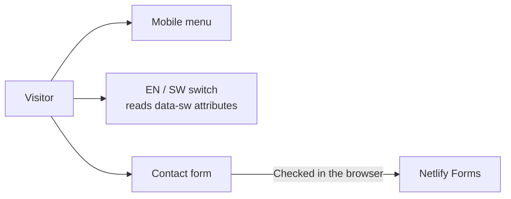

<p align="center">
  
</p>

<p align="center">
  
  
  
  
</p>

<p align="center">
  <a href="#what-this-is">What this is</a> ·
  <a href="#what-the-site-covers">Sections</a> ·
  <a href="#the-design-idea">Design</a> ·
  <a href="#run-and-deploy">Run it</a> ·
  <a href="#make-it-your-own-school">Make it yours</a>
</p>

---

## What this is

A bilingual (English and Kiswahili) website for a secondary school in **Dar es Salaam**. The school is named **School 1** for example purposes: it is a ready-made starting point that a real school can adopt by changing the name, text and photos.

## What the site covers

| Section | Anchor | Purpose |
|---|---|---|
| Hero | `#top` | "Building Minds, Building a Nation" with **Book a Visit** |
| About | `#about` | A school that knows every student |
| Academics | `#academics` | Subject offering |
| Campus | `#campus` | Life beyond the classroom |
| Admissions | `#admissions` | Three steps to join, with **Start Your Application** |
| Contact | `#contact` | Enquiry form with validation |

## The design idea

The page looks like **ruled exercise-book paper**: a warm paper background, faint blue rule lines and a red margin line, with navy ink and gold accents. It is meant to feel like a school notebook and still read clearly on a phone.

| Token | Colour | Use |
|---|---|---|
| Paper | `#FBF8F1` | Page background |
| Rule | `#C7D9E8` | Notebook lines |
| Margin | `#C0392B` | Margin line, primary buttons |
| Ink | `#16213E` | Text and headings |
| Gold | `#E8A33D` | Highlights |

## How it works



- **Language switch:** each text element holds its Kiswahili in a `data-sw` attribute and `script.js` swaps it in.
- **Form:** client-side validation is for convenience only; Netlify Forms receives the submission.
- **Accessible:** semantic HTML, skip-friendly landmarks and an `aria-expanded` menu button.

## Files

| File | Purpose |
|---|---|
| `index.html` | The page |
| `style.css` | Notebook theme and layout |
| `script.js` | Menu, language switch, form validation |
| `logo.jpg` | School logo |

## Run and deploy

```bash
npx serve .
```

Deploy by connecting the repository to Netlify with no build command, or upload the folder to any static host. Contact-form delivery needs Netlify.

## Make it your own school

1. Replace the name "School 1" in `index.html` and the `logo.jpg` image.
2. Edit the English text and its `data-sw` Kiswahili in `index.html`.
3. Update the contact details and the Netlify form notification address.
